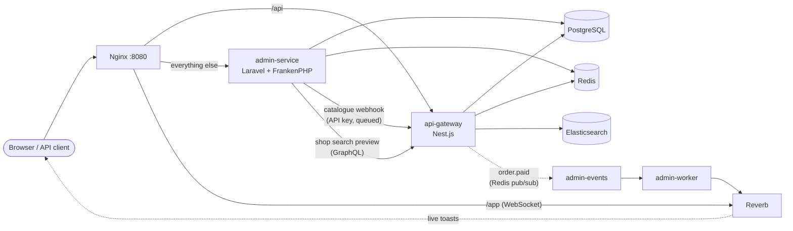

# E-commerce Platform

[](https://github.com/RenalAhmedov/ecommerce-platform/actions/workflows/ci.yml)

A hybrid e-commerce backend: a **Nest.js API gateway** for the shop (customers, catalogue, checkout) and a **Laravel admin panel** for the people running it, sharing one PostgreSQL database, one Redis and one login.

| | api-gateway (Nest.js 12, Node 24) | admin-service (Laravel 13, PHP 8.4) |
|---|---|---|
| For | customers and shop frontends | admins |
| Offers | REST API with Swagger, read-only GraphQL, JWT auth | Blade panel, JSON admin API |
| Highlights | product catalogue with Redis cache and Elasticsearch search (typo-tolerant, relevance), checkout with stock reservation, mock payment and idempotency keys, confirmation emails on a queue, rate limiting, token revocation | product CRUD with image processing and CSV import/export, nested categories, order management, dashboard, sales reports (CSV/PDF), user management, live order notifications over WebSockets, shop search preview |

Everything runs in Docker. Nothing else needs to be installed.

## Quick start

Requirements: [Docker Desktop](https://www.docker.com/products/docker-desktop/) (or Docker Engine with Compose v2), about 4 GB of memory for Docker, and a POSIX shell (macOS, Linux, or WSL on Windows).

```bash
git clone https://github.com/RenalAhmedov/ecommerce-platform.git
cd ecommerce-platform
./scripts/setup.sh
```

[`scripts/setup.sh`](scripts/setup.sh) creates the three `.env` files with freshly generated secrets (the ones both services must share are made to match), builds the panel's CSS/JS, starts the whole platform, waits until it is healthy and loads the demo data. The first run takes a few minutes; running it again changes nothing that already exists.

| What | Where | Login |
|---|---|---|
| Admin panel | http://localhost:8080 | `admin@example.com` / `password123` |
| REST API + Swagger | http://localhost:8080/api/docs | customers: `ada.lovelace@example.com` (and 7 more) / `password123` |
| GraphQL | `POST http://localhost:8080/api/graphql` | same tokens as REST |
| Admin JSON API | http://localhost:8080/admin/api | an admin's access token |
| Emails (Mailpit) | http://localhost:8025 | |

The demo data: 1 admin, 8 customers, a category tree, 20 products with pictures and stock (some low, one sold out, one inactive) and 24 orders over the last 30 days in every status.

Day to day: `docker compose up -d` / `docker compose stop`; `docker compose logs -f api-gateway` (or any service); `docker compose down -v` wipes all data.

### Try it

```bash
# log in as a customer and keep the token
TOKEN=$(curl -s -X POST localhost:8080/api/auth/login -H 'Content-Type: application/json' \
  -d '{"email":"ada.lovelace@example.com","password":"password123"}' | sed -E 's/.*"accessToken":"([^"]+)".*/\1/')

# search with a typo (Elasticsearch)
curl -s 'localhost:8080/api/products?search=headphnes&sortBy=relevance'

# the same through GraphQL, asking only for the fields needed
curl -s localhost:8080/api/graphql -H 'Content-Type: application/json' \
  -d '{"query":"{ products(search: \"headphnes\") { data { name price stock } } }"}'

# your orders
curl -s localhost:8080/api/orders -H "Authorization: Bearer $TOKEN"
```

A [Postman collection](postman/ecommerce-api.postman_collection.json) walks through everything (auth, products, checkout including idempotency and stock conflicts, token revocation, search, GraphQL, the admin API, rate limiting), with a check on every response.

## Architecture



| Container | Role |
|---|---|
| `nginx` | single entry point: `/api` → Nest, `/app` → Reverb, the rest → Laravel; request ids, real client IPs |
| `api-gateway`, `api-migrate` | the Nest app; its migrations (it owns the shared schema) run once before anything starts |
| `admin-service`, `admin-migrate` | the Laravel app served by FrankenPHP; its own few tables |
| `admin-worker` | Laravel queue: image processing, imports, webhooks, broadcasts |
| `admin-events` | turns Nest's `order.paid` events into live notifications |
| `reverb` | WebSocket server for the panel |
| `postgres`, `redis`, `elasticsearch`, `mailpit` | data, cache/queues/sessions, product search, caught emails |

### How the two services work together

- **One database, one owner.** Both services read and write the same tables; Nest owns the schema (TypeORM migrations), and Laravel keeps a copy of the definitions for its tests plus its own history table. The same uniqueness rules are enforced on both sides with the same PostgreSQL advisory-lock keys (e.g. `products.sku:<SKU>`), so a shop sign-up and an admin can't create the same email at the same moment.
- **One login.** Nest issues the JWTs; Laravel verifies the same tokens for its admin API, and an admin can open the panel with a Nest token (a shared session that ends when either side logs out). Logouts, deleted users, demotions and password changes revoke tokens in both services through shared Redis keys.
- **Catalogue changes** made in the panel reach Nest through an API-key webhook, sent from Laravel's queue with retries and de-duplicated by event id; Nest drops its cached product responses and re-syncs its search index.
- **Live updates.** Paid orders (from Nest) and status changes (from other admins) appear in every open panel within a second, through Reverb and Echo.
- **Traceability.** Nginx gives every request an id that travels into both services' logs and across the webhook and GraphQL calls between them.

## Testing

Only Docker is needed:

```bash
docker compose run --rm api-tests      # Nest: 286 unit + 42 integration tests
docker compose run --rm admin-tests    # Laravel: 282 unit + integration tests
```

Unit tests mock every collaborator. Integration tests run the real application over HTTP against real PostgreSQL, Redis and Elasticsearch, started as throwaway containers with [Testcontainers](https://testcontainers.com/) for each run, so the development data is never touched. They include the hard cases: concurrent registrations and orders racing for the last items, idempotent retries, cache invalidation, a search index catching up with changes made straight in the database, and falling back to Postgres when Elasticsearch stops.

## CI/CD

[GitHub Actions](.github/workflows/ci.yml) on every pull request and push to `main`: formatting, lint, typecheck and all tests of both services, the frontend build and a check of the compose and Nginx configuration. On `main`, once everything passes, both production images are built and pushed to GitHub's container registry (`ghcr.io/renalahmedov/ecommerce-platform-api-gateway` and `…-admin-service`). Actions are pinned to commit SHAs; Dependabot proposes updates weekly.

## Production

`docker compose -f docker-compose.prod.yml up -d --build` runs the production-like stack on http://localhost:8090, with its own data: images with the code baked in (multi-stage builds, unprivileged users, health checks), production PHP and Node settings, `queue:work`, no Swagger or GraphQL introspection, only Nginx published. Secrets come from the services' `.env` files.

## Design decisions

- **Shared database instead of service-to-service calls for data.** The admin panel works on the same rows the shop does, so nothing has to be copied or kept in sync, and a report is a query rather than a distributed join. The price is coupling on the schema, which is why one service owns it and both enforce the same rules with the same locks.
- **Correctness under concurrency.** Stock is reserved under row locks taken in a fixed order (no deadlocks, no overselling), order totals are computed from database prices in cents, checkout accepts an `Idempotency-Key`, and uniqueness checks run under advisory locks. Each of these has an integration test that races real requests.
- **Degrade, don't fail.** Redis being down disables caching and rate limiting but not the shop; Elasticsearch being down falls back to Postgres search; a missed webhook is caught up by a scheduled sync. The exceptions fail closed on purpose: logging out and revoking a deleted user's tokens refuse to report success while Redis can't record them.
- **Elasticsearch finds, Postgres answers.** The index holds only what is searched; prices and stock always come from the database. For a small catalogue Postgres alone would do; Elasticsearch earns its place with typo tolerance, relevance and large catalogues.
- **Queues for anything slow or retryable**: emails, image processing, imports, webhooks, broadcasts.
- **Layering in both services**: controllers stay thin, services hold the rules, repositories are the only code that talks to a data store.

## Repository layout

```
├── api-gateway/          Nest.js API gateway          → api-gateway/README.md
├── admin-service/        Laravel admin panel          → admin-service/README.md
├── nginx/                reverse proxy config
├── database/schema/      reference SQL, one file per table
├── postman/              API walkthrough collection
├── scripts/setup.sh      first start of a fresh clone
├── docker-compose.yml    development stack (+ test runners)
└── docker-compose.prod.yml
```

## Troubleshooting

- **`Cannot connect to the Docker daemon`**: start Docker Desktop and wait until it is running.
- **`port is already allocated`**: something else uses that port. Every published port can be changed in the root `.env` (`HTTP_PORT`, `DB_PORT`, `REDIS_PORT`, …, see [`.env.example`](.env.example)).
- **Elasticsearch keeps restarting or the stack is slow**: give Docker more memory (Docker Desktop → Settings → Resources; about 4 GB).
- **`/api/health` says `degraded`** right after starting: Elasticsearch takes about half a minute; search uses Postgres until then.
