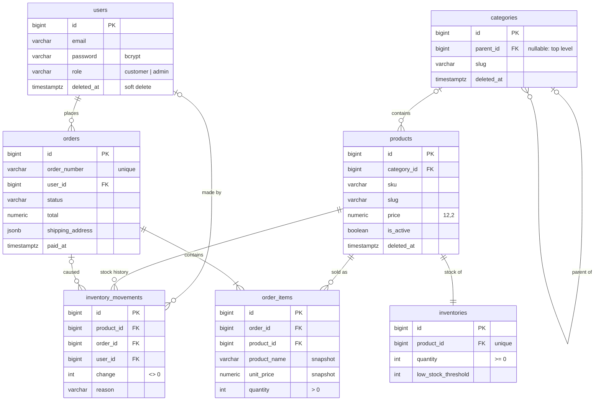

# Database design

PostgreSQL 16, shared by both services. The reference schema is in [`schema/`](schema), one file per table, in creation order. The same schema exists as migrations for both frameworks:

| | Migrations | Run by |
|---|---|---|
| Nest.js (TypeORM), the owner of the shared tables | [`api-gateway/src/database/migrations/`](../api-gateway/src/database/migrations) | `api-migrate`, before anything else starts; history in `migrations` |
| Laravel, an exact copy of the same tables | [`admin-service/database/migrations/shared/`](../admin-service/database/migrations/shared) | only by Laravel's integration tests, to build their throwaway database |
| Laravel's own tables: `password_reset_tokens`, `failed_jobs`, `product_imports` | [`admin-service/database/migrations/`](../admin-service/database/migrations) | `admin-migrate`, after Nest's; history in `laravel_migrations` |

One owner per table and separate history tables mean neither framework ever tries to create or change the other's tables.

| Table | Holds |
|---|---|
| `users` | customers and admins, told apart by `role` |
| `categories` | a tree of any depth (`parent_id` points to the parent) |
| `products` | the catalogue; price, SKU, slug, picture, active flag |
| `inventories` | one row per product: how many are in stock now |
| `inventory_movements` | every stock change ever made: initial stock, sales, returned stock of cancelled orders, corrections |
| `orders` | one row per checkout: status, totals, payment reference, shipping address |
| `order_items` | the order's lines, with the product's name and price at the time of sale |

## Design choices

**One `users` table with a `role` column.** Customers and admins log in the same way, with the same password rules and the same JWT, which is what lets one token work in both services. Two roles don't justify a roles/permissions table; a `CHECK` keeps the column to the two known values.

**Money is `NUMERIC(12,2)`, never a float.** Totals are computed in whole cents in code and stored as exact decimals, so `0.10 × 3` is `0.30`, not `0.30000000000000004`.

**Stock lives in its own table.** Checkout locks the `inventories` rows of the ordered products (always in product-id order, so two checkouts can't deadlock), not the products themselves, so editing a product's description never waits for a checkout. `CHECK (quantity >= 0)` is the last line of defence against overselling: even a bug in the code can't push stock below zero.

**Every stock change is recorded in `inventory_movements`.** Rows are only ever added, each with a reason (`initial`, `sale`, `cancellation`, `restock`, `adjustment`) and the order or admin that caused it. The current stock is always the sum of the product's movements, which makes every number explainable and is checked by the seeder tests.

**Orders keep what was true at the time of sale.** `order_items` copies the product's name and unit price, and `orders` keeps the shipping address as `JSONB`, so later price changes, renamed products or a customer's new address never rewrite history (and no addresses table is needed). `subtotal` and `total` are separate so shipping or discounts can be added without a migration. `paid_at` is what sales reports count by.

**Each order has a public `order_number`** (`ORD-20261024-8AAFEFA0`) for customers and emails, so the sequential `id` isn't exposed and order volume can't be guessed.

**Statuses are `VARCHAR` with a `CHECK`, not PostgreSQL enums.** Both frameworks' migrations can change a check constraint simply, while altering a native enum type is awkward, especially inside a transaction.

**Delete rules follow ownership.** History is protected: an order can't lose its customer (`RESTRICT`) and a sold product can't be hard-deleted (`RESTRICT`). Owned rows go with their owner (an order's items, a product's stock row: `CASCADE`). Optional references are cleared (`SET NULL`): a product whose category is removed simply becomes uncategorised.

**Soft deletes where restoring makes sense.** Users, categories and products have `deleted_at` and can be restored from the admin panel; their orders keep pointing at them. Orders are never deleted: their `status` says what happened (`cancelled`, `payment_failed`). `is_active` is separate from `deleted_at`: inactive products are hidden from the shop but still managed; deleted ones are gone until restored.

**Categories are an adjacency list.** `parent_id` allows any depth with the simplest structure; a `CHECK` stops a category from being its own parent, and the admin service prevents longer cycles (moving a category under its own descendant) with a recursive query under a lock.

**Uniqueness is enforced by the application, under locks.** Emails must be unique ignoring case (SKUs and slugs are normalised to one case on input), and a value stays taken by a deleted row, so restoring a user or product can never create a duplicate. Both services check this inside a transaction holding a PostgreSQL advisory lock on the value (e.g. `users.email:ada@example.com`), using the same lock keys, so even a shop sign-up and an admin creating the same email at the same moment can't both succeed (tested with 10 concurrent requests). A unique index on `LOWER(email)` would add a database-level backstop and is the natural next step if a third service ever wrote to these tables.

**Indexes only where a query needs them.** Apart from the primary keys and the three unique constraints (`orders.order_number`, one stock row per product, one line per product in an order), there are no indexes yet: every index slows down writes, so each should be justified by a real query. PostgreSQL does not index foreign keys automatically; with real traffic the first candidates would be `orders (user_id, created_at)` for customers' order lists, and `order_items (product_id)` and `inventory_movements (product_id)` for the admin pages.

**Identity columns and time zones.** Ids are `BIGINT GENERATED ALWAYS AS IDENTITY` (the SQL standard successor of `SERIAL`); every timestamp is `TIMESTAMPTZ`, stored in UTC.
